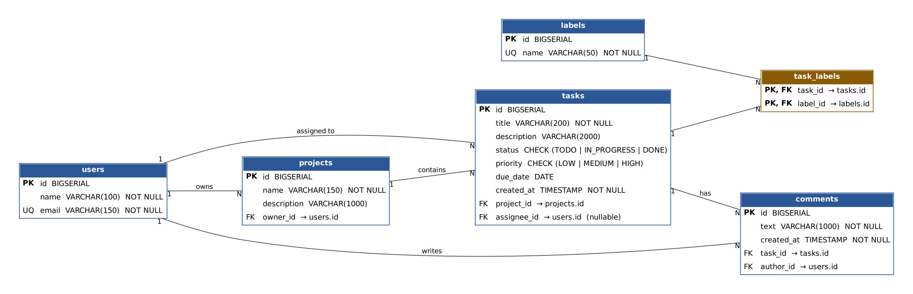

# Task Tracker — учёт задач (курсовой проект)

Backend на **Java 17 + Spring Boot 3 + PostgreSQL**. REST API для учёта задач по проектам: пользователи, проекты, задачи, метки, комментарии.

## Быстрый запуск (Docker, рекомендуется)

```bash
docker compose up --build -d
```

Через ~30–60 секунд откройте в браузере:

- http://localhost:8008/api/tasks/ — список задач (JSON)
- http://localhost:8008/api/projects
- http://localhost:8008/api/users
- http://localhost:8008/api/reports/projects

Остановить: `docker compose down` (данные сохраняются в volume `pgdata`; `docker compose down -v` — удалить и данные).

На сервере то же самое: скопировать папку проекта, выполнить `docker compose up --build -d`. Порт 8008 должен быть открыт.

## Запуск без Docker

1. Установить Java 17+, Maven и PostgreSQL.
2. Создать БД: `CREATE DATABASE taskdb;`
3. При необходимости задать переменные окружения `DB_URL`, `DB_USER`, `DB_PASSWORD`
   (по умолчанию `jdbc:postgresql://localhost:5432/taskdb`, `postgres` / `postgres`).
4. `mvn spring-boot:run`

Таблицы и стартовые данные создаются автоматически при запуске (`schema.sql`, `data.sql`).

## Эндпоинты

| Метод | URL | Описание |
|-------|-----|----------|
| GET | `/api/tasks` | все задачи |
| GET | `/api/tasks/{id}` | одна задача |
| GET | `/api/tasks/search?q=&status=&priority=&projectId=&assigneeId=` | **поиск** (все параметры необязательные) |
| POST / PUT / DELETE | `/api/tasks`, `/api/tasks/{id}` | **CRUD задач** |
| GET / POST | `/api/tasks/{id}/comments` | комментарии к задаче |
| GET, POST, PUT, DELETE | `/api/projects`, `/api/projects/{id}` | **CRUD проектов** |
| GET | `/api/projects/{id}/tasks` | задачи проекта |
| GET, POST, PUT, DELETE | `/api/users`, `/api/users/{id}` | **CRUD пользователей** |
| GET, POST, PUT, DELETE | `/api/labels`, `/api/labels/{id}` | метки |
| GET | `/api/reports/projects` | **отчёт**: задачи и % выполнения по проектам |
| GET | `/api/reports/users` | **отчёт**: нагрузка и просроченные задачи по людям |
| GET | `/api/reports/labels` | **отчёт**: число задач по меткам |

Допустимые значения: `status` = `TODO | IN_PROGRESS | DONE`, `priority` = `LOW | MEDIUM | HIGH`.

## Примеры запросов

```bash
# поиск: задачи со словом "api" и статусом IN_PROGRESS
curl "http://localhost:8008/api/tasks/search?q=api&status=IN_PROGRESS"

# создать задачу
curl -X POST http://localhost:8008/api/tasks \
  -H "Content-Type: application/json" \
  -d '{"title":"Написать тесты","status":"TODO","priority":"MEDIUM","dueDate":"2026-12-01","projectId":3,"assigneeId":3,"labelIds":[1,5]}'

# изменить задачу
curl -X PUT http://localhost:8008/api/tasks/10 \
  -H "Content-Type: application/json" \
  -d '{"title":"Write README and report","status":"DONE","priority":"MEDIUM","projectId":3,"assigneeId":1}'

# удалить задачу
curl -X DELETE http://localhost:8008/api/tasks/10

# проверка валидации (вернётся 400 с описанием ошибок)
curl -X POST http://localhost:8008/api/tasks -H "Content-Type: application/json" -d '{"title":"","projectId":1}'
```

## Коды ответов

| Код | Когда |
|-----|-------|
| 200 / 201 / 204 | успех / создано / удалено |
| 400 | ошибка валидации, неверный JSON, неверное значение enum |
| 404 | запись не найдена |
| 409 | нарушение ограничения (дубликат email, удаление пользователя, который владеет проектом) |

## Структура проекта

```
src/main/java/com/example/tasktracker/
  controller/   REST-контроллеры
  service/      бизнес-логика, транзакции
  repository/   Spring Data JPA + Specification для поиска
  model/        JPA-сущности и enum
  dto/          запросы (с валидацией) и ответы
  exception/    единый обработчик ошибок
src/main/resources/
  application.properties, schema.sql, data.sql
docs/           REPORT.md/.docx, ER и class diagram (.png, .dot)
Dockerfile, docker-compose.yml
```

## Диаграммы

- ER-диаграмма: `docs/er-diagram.png`
- Диаграмма классов: `docs/class-diagram.png`
- Отчёт: `docs/REPORT.md` (и `docs/REPORT.docx`)


