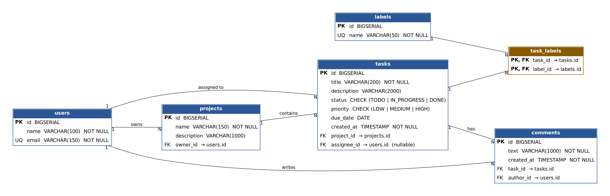
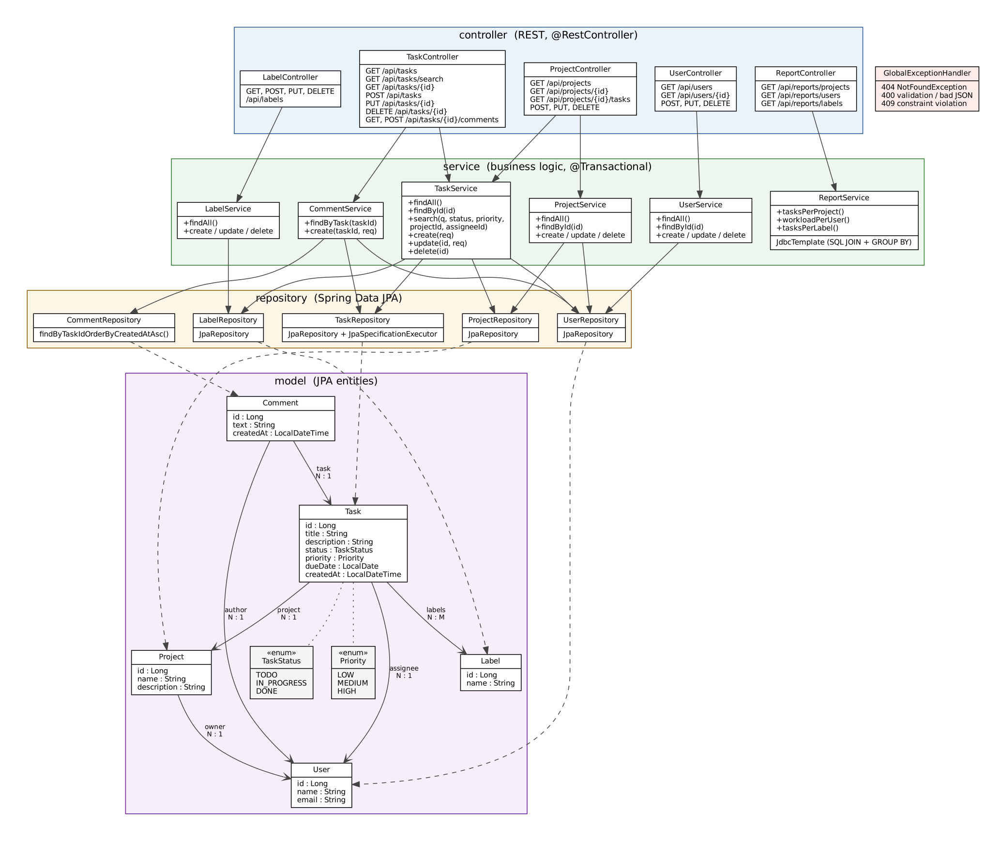

# 1. Цель и описание

Backend-приложение для учёта задач. Пользователи работают в проектах, в проектах создаются задачи с приоритетом, статусом и сроком, задачи можно назначать на людей, помечать метками и комментировать. Данные хранятся в PostgreSQL, доступ к ним — через REST API в формате JSON.

**Технологии:** Java 17, Spring Boot 3.3 (Web, Data JPA, Validation), PostgreSQL 16, Maven, Docker.

# 2. Архитектура

Приложение разделено на слои (классическая трёхслойная архитектура):

- **controller** — принимает HTTP-запросы, проверяет входные данные (`@Valid`), возвращает JSON;
- **service** — бизнес-логика и транзакции (`@Transactional`), проверка существования связанных записей;
- **repository** — доступ к БД через Spring Data JPA; для динамического поиска используется `Specification`;
- **model** — JPA-сущности (`User`, `Project`, `Task`, `Label`, `Comment`) и перечисления (`TaskStatus`, `Priority`);
- **dto** — отдельные классы запросов и ответов (record), сущности наружу не отдаются;
- **exception** — `GlobalExceptionHandler` превращает ошибки в понятные JSON-ответы с кодами 400/404/409.

Схема классов — на диаграмме в разделе 7.

# 3. База данных

В схеме **6 связанных таблиц** (требование 4–7):

| Таблица | Назначение | Связи |
|---------|-----------|-------|
| `users` | пользователи | — |
| `projects` | проекты | `owner_id` → `users` (N:1) |
| `tasks` | задачи | `project_id` → `projects` (N:1), `assignee_id` → `users` (N:1, может быть пустым) |
| `labels` | метки | — |
| `task_labels` | связь «задача — метка» | `task_id` → `tasks`, `label_id` → `labels` (M:N) |
| `comments` | комментарии | `task_id` → `tasks`, `author_id` → `users` |

**Нормализация (3NF):**

- 1NF: все поля атомарны, у каждой таблицы есть первичный ключ.
- 2NF: везде простые ключи (`id`), в `task_labels` составной ключ, но неключевых полей в ней нет — частичных зависимостей нет.
- 3NF: нет транзитивных зависимостей. Имя проекта, имя владельца и имя исполнителя не хранятся в `tasks` — там только внешние ключи. Метки вынесены в отдельную таблицу и связь M:N, а не хранятся строкой в задаче.

Целостность обеспечивают `PRIMARY KEY`, `FOREIGN KEY`, `UNIQUE` (email, имя метки), `NOT NULL`, `CHECK` для `status` и `priority`, а также каскадное удаление (удаление проекта удаляет его задачи) и `ON DELETE SET NULL` для исполнителя.

Таблицы создаёт файл `schema.sql`, стартовые данные (4 пользователя, 3 проекта, 5 меток, 10 задач, комментарии) — `data.sql`. Оба файла запускаются при каждом старте и безопасны для повторного запуска (`IF NOT EXISTS`, `ON CONFLICT DO NOTHING`).

# 4. Функциональность

**Полный CRUD** реализован для трёх сущностей: задачи, проекты, пользователи (плюс метки и добавление комментариев).

**Поиск:** `GET /api/tasks/search?q=&status=&priority=&projectId=&assigneeId=`. Текст ищется в названии и описании без учёта регистра; любые фильтры можно комбинировать, все они необязательные.

**Отчёты** (SQL с `JOIN` и агрегатами `COUNT`, `SUM`, `GROUP BY`, выполняются через `JdbcTemplate`):

| Эндпоинт | Что показывает | SQL-приёмы |
|----------|----------------|-----------|
| `/api/reports/projects` | задач в проекте, выполнено, % выполнения, владелец | `JOIN users` + `LEFT JOIN tasks`, `COUNT`, `SUM(CASE…)` |
| `/api/reports/users` | задач на человека, из них просрочено | `LEFT JOIN`, условная сумма по `due_date < CURRENT_DATE` |
| `/api/reports/labels` | сколько задач у каждой метки | `LEFT JOIN task_labels` (связь M:N), `COUNT` |

**Валидация ввода** (Bean Validation в DTO): обязательные поля (`@NotBlank`, `@NotNull`), ограничение длины (`@Size`), формат email (`@Email`). Неверный JSON, неизвестное значение enum или несуществующий `projectId` возвращают понятную ошибку: 400 с перечнем полей, 404 или 409.

# 5. Запуск и развёртывание

Проект запускается одной командой: `docker compose up --build -d`.

- `Dockerfile` — многоступенчатая сборка: в первом этапе Maven собирает jar, во втором в лёгком образе JRE запускается приложение (под обычным пользователем, не root).
- `docker-compose.yml` — два сервиса: `db` (PostgreSQL с проверкой готовности и volume для данных) и `app` (стартует, когда БД готова). Настройки подключения передаются переменными окружения `DB_URL`, `DB_USER`, `DB_PASSWORD`.

После запуска список задач доступен по адресу `http://localhost:8008/api/tasks/`.

# 6. Соответствие требованиям

| Требование | Где выполнено |
|-----------|---------------|
| 4–7 связанных таблиц, 3NF | 6 таблиц, раздел 3, `schema.sql` |
| CRUD минимум по двум сущностям | задачи, проекты, пользователи (+ метки) |
| Поиск и отчёт (JOIN + агрегаты) | `/api/tasks/search`, `/api/reports/*` |
| Валидация ввода | DTO с аннотациями + `GlobalExceptionHandler` |
| README + ER + class diagram | `README.md`, `er-diagram.png`, `class-diagram.png` |

# 7. Диаграммы

## ER-диаграмма

## Диаграмма классов

# 8. Вопросы, которые может задать преподаватель

- **Зачем DTO, а не сущности в JSON?** Чтобы не отдавать лишние поля, не получать ошибки ленивой загрузки и отделить API от структуры БД.
- **Зачем `task_labels`?** Задача может иметь много меток, а метка — относиться ко многим задачам: связь M:N разворачивается через таблицу-связку.
- **Почему отчёты на чистом SQL?** Так видно `JOIN` и агрегаты, и запрос проще проверить прямо в `psql`.
- **Как работает поиск?** `Specification` собирает `WHERE` из только заданных параметров.
- **Что будет при удалении пользователя?** Если он владелец проекта — 409 (внешний ключ). Если исполнитель — у его задач `assignee_id` становится `NULL`.
